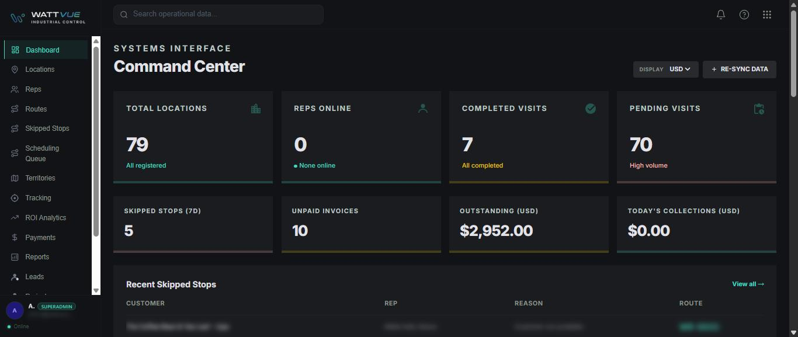
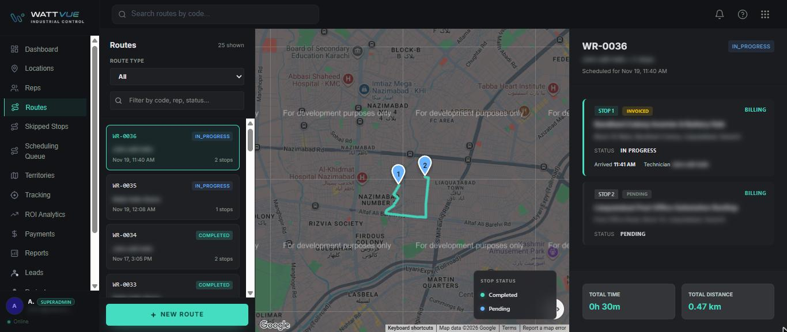
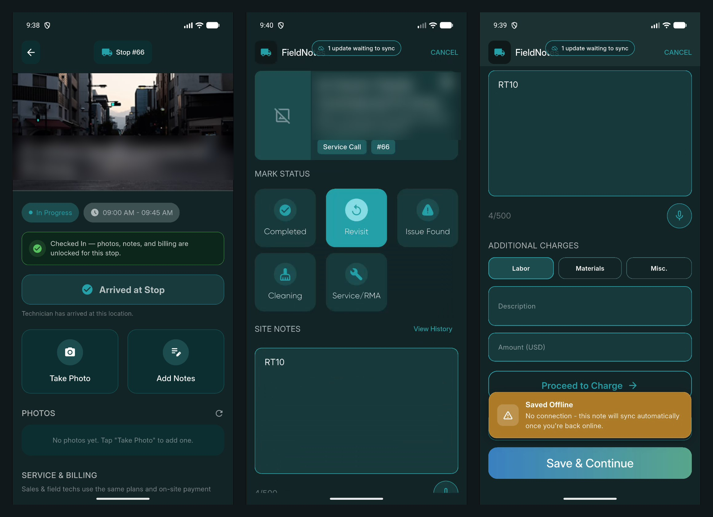
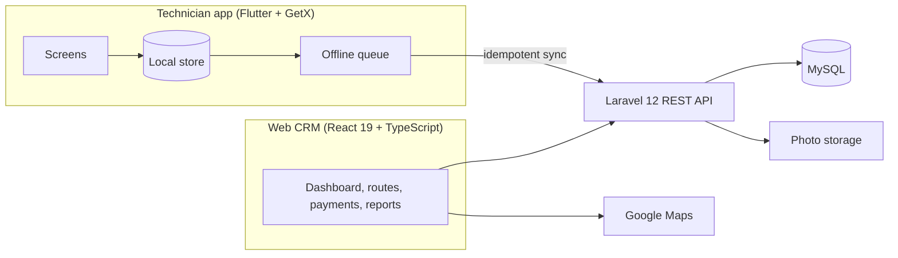

# WattVue: Field-Service Platform

**Case study.** Built for a solar field-service company. The source code is private, and all customer and staff data in the screenshots is blurred.

**My role:** Sole developer. I designed and built the API, the web CRM and the technician mobile app.
**Timeline:** 2026 (contract)

## The problem

The company sends technicians to many customer sites every day for service calls, cleaning and repairs. Routes were planned by hand, visit notes and photos were scattered, and billing for extra work on site was often missed. Technicians also lose signal in the field, so their app has to keep working offline.

## What I built

- **Web CRM (React).** A command center for managers: locations, reps, routes on a map, skipped stops, a scheduling queue, territories, payments, invoices and reports.
- **Technician app (Flutter).** Daily route, check-in at each stop, status updates, categorized photos, voice or text notes and on-site charges. Everything is saved offline first and synced later.
- **API (Laravel).** One backend for both, with role-based access.

## Architecture

## Engineering decisions

- **Offline queue with idempotent sync.** Every action in the app gets a unique key before it is queued. If the network drops halfway and the app retries, the server applies the action only once, so there are no duplicate visits or charges.
- **Check-in gates the work.** Photos, notes and billing unlock only after a technician checks in at the stop, which keeps records tied to a real visit.
- **Route view built for dispatchers.** Routes, stops and their status are shown on a map, with total time and distance per route.
- **Clear status model.** Each stop moves through defined states (pending, in progress, completed, revisit, issue found), which the reports and the dashboard read from.

## Stack

Flutter, GetX · React 19, TypeScript · Laravel 12, MySQL · Google Maps

---

Aliyan Siddiqui · [Portfolio](https://portfolio-aliyan-siddiqui.netlify.app) · [LinkedIn](https://www.linkedin.com/in/aliyan-siddiqui555/)
